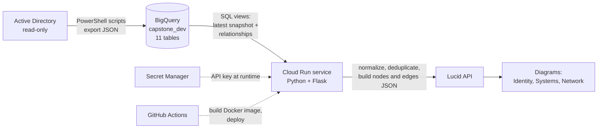

# Active Directory to Cloud Data Pipeline (Capstone)

An automated pipeline that moves identity data from Active Directory into Google BigQuery, processes it with a Python service on Cloud Run, and sends it to Lucid to draw relationship diagrams.

> **Team project.** This repository holds **my part** of the work: the Cloud Run service and the architecture diagram.
> The full team repository (PowerShell extraction, BigQuery SQL, automation) is here:
> **[github.com/kokoAfantchao/Capstone-ProjectTeam3](https://github.com/kokoAfantchao/Capstone-ProjectTeam3)**

---

## Overview

Our industry sponsor, Cybriant (a managed security services company), uses Lucid to show diagrams of a customer's IT environment.
Before this project, an analyst had to export **Active Directory (AD)** data by hand, clean it in Excel, and upload it again.
AD is the Microsoft system that stores users, computers, and groups in a company network.

The manual process was slow, the data was often old, and there was no record of *when* or *what* was updated.

We built a pipeline that runs on a schedule with no manual steps. Each run is tagged with an ID and a timestamp, so every row of data can be traced back to the run that created it.

## Pipeline



1. **Extract** – PowerShell scripts read AD in read-only mode and export users, groups, computers, OUs, DNS records, and DHCP data as JSON.
2. **Stage and validate** – The data is loaded into **BigQuery** (Google's cloud data warehouse) in 11 tables. Each row has a `run_id` and a `snapshot_ts` (snapshot timestamp).
3. **Process** – The **Cloud Run** service (a serverless container on Google Cloud) reads the latest snapshot, cleans it, and maps AD fields to the format Lucid expects.
4. **Visualize** – The service sends a JSON payload of *nodes* (things) and *edges* (relationships) to the Lucid API.

## What I did

My role on the team was **Cloud Run and integration developer**.

- Built the Python **Flask** service that runs on Cloud Run and reads data from BigQuery.
- Worked on **data transformation and normalization**: making strings consistent, removing duplicates, and mapping AD fields to the Lucid format.
- Wrote the **Dockerfile** and worked on the **CI/CD** flow (CI/CD = automatic build and deploy on every code change): GitHub Actions → Docker image → Artifact Registry → Cloud Run.
- Helped design the **`run_id` / `snapshot_ts` tracking**, so each pipeline run can be traced and the "latest" data can be selected.
- Did **integration testing** – checking that data flows correctly from one stage to the next.
- Supported documentation and testing for the team.

## Key code: the fuzzy LEFT JOIN

This is the query inside `cloudrun-service/main.py`. It links each computer to its DNS record (DNS maps a host name to an IP address).

```sql
SELECT c.name, c.dns_host_name, d.host_name, d.ipv4_address
FROM `<project>.capstone_dev.computer` c
LEFT JOIN `<project>.capstone_dev.dns_a_record` d
  ON LOWER(c.dns_host_name) LIKE CONCAT('%', LOWER(d.host_name), '%')
LIMIT 20
```

**In plain words:**

- A **LEFT JOIN** keeps *every* computer, even if no DNS record matches. If there is no match, the DNS columns are just empty (NULL). We do not lose any computers.
- It is **fuzzy** because it does not need an exact match. A computer's full name is often longer, like `pc01.company.local`, while the DNS record only says `pc01`. The `LIKE '%pc01%'` test asks: *"does the long name contain the short name?"*
- `LOWER()` makes both sides lowercase, so `PC01` and `pc01` still match.
- **Trade-off:** fuzzy matching can create false matches (for example `pc1` is also inside `pc10`). For production, an exact match on a cleaned host name is safer.

The service returns the result as JSON:

```python
results = client.query(query).result()
data = [{"name": r.name, "dns": r.dns_host_name,
         "host": r.host_name, "ip": r.ipv4_address} for r in results]
return jsonify(data)
```

## Validation and data quality

We checked data at each stage. All **7 of 7 test cases passed**.

| Check | What we verified |
|---|---|
| Row-count reconciliation | Counts in BigQuery match what was extracted from AD (no missing or extra rows). |
| `run_id` / snapshot checks | All 11 tables have a valid `run_id` and `snapshot_ts`; scheduled runs on different dates create new run IDs. |
| View counts | Relationship views return the expected rows: computer→OU = 89, user→OU = 88, DNS→computer = 3. |
| CI/CD | Each push to `main` builds and deploys automatically (28+ successful deploys by the final demo). |
| End-to-end | Identity, systems, and network diagrams appear correctly in the Lucid sandbox. |

## Tech used

Python · Flask · Gunicorn · Google BigQuery (SQL) · Google Cloud Run · Docker · Artifact Registry · GitHub Actions · Secret Manager · PowerShell (team) · Lucid REST API · PlantUML

## Repository contents

```
cloudrun-service/
  main.py            Flask app: reads BigQuery and returns JSON
  Dockerfile         Container image for Cloud Run
  requirements.txt   flask, gunicorn, google-cloud-bigquery
docs/
  architecture.puml  Three-layer design: Extraction → Staging → Presentation
```

This folder contains a simplified version of the service (the BigQuery read endpoint). The full Lucid integration and the GitHub Actions workflow are in the team repository.

## How to run

You need a Google Cloud project with BigQuery tables that use the same names. Update the project and dataset names in `main.py` first.

```bash
cd cloudrun-service
python -m venv .venv && source .venv/bin/activate
pip install -r requirements.txt
gcloud auth application-default login   # gives the BigQuery client your credentials
python main.py                          # open http://localhost:8080
```

With Docker:

```bash
docker build -t ad-pipeline-service cloudrun-service
docker run -p 8080:8080 -e PORT=8080 ad-pipeline-service
```

Never commit API keys. In the real pipeline, keys are read from Secret Manager at runtime.

## What I learned

- How to design a pipeline in **layers** (extract → stage → present), so each part can be tested alone.
- Why **run IDs and timestamps** matter: they give an audit trail and make "latest snapshot" queries simple.
- How a LEFT JOIN protects you from losing records, and why fuzzy matching needs care.
- How CI/CD makes deployment repeatable and removes manual mistakes.
- How to work with a real client: requirements, milestones, demos, and security rules (read-only access, least privilege, no secrets in code).

## Team

| Member | Role |
|---|---|
| Shahiba Shamshad | Team lead – AD extraction and Cloud Run / Lucid API |
| Michael Butler | BigQuery tables, views, and validation SQL |
| Koko Afantchao | Automation, AD extraction, GitHub Actions |
| **Mounia Touil** | **Cloud Run and integration developer** |

**Course:** SWE 7903 Software Engineering Capstone · Kennesaw State University · Spring 2026
**Sponsor:** Cybriant
